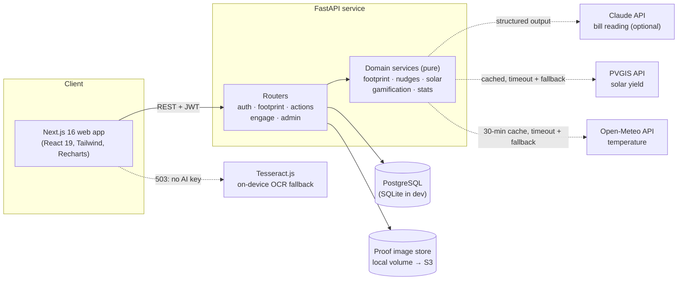
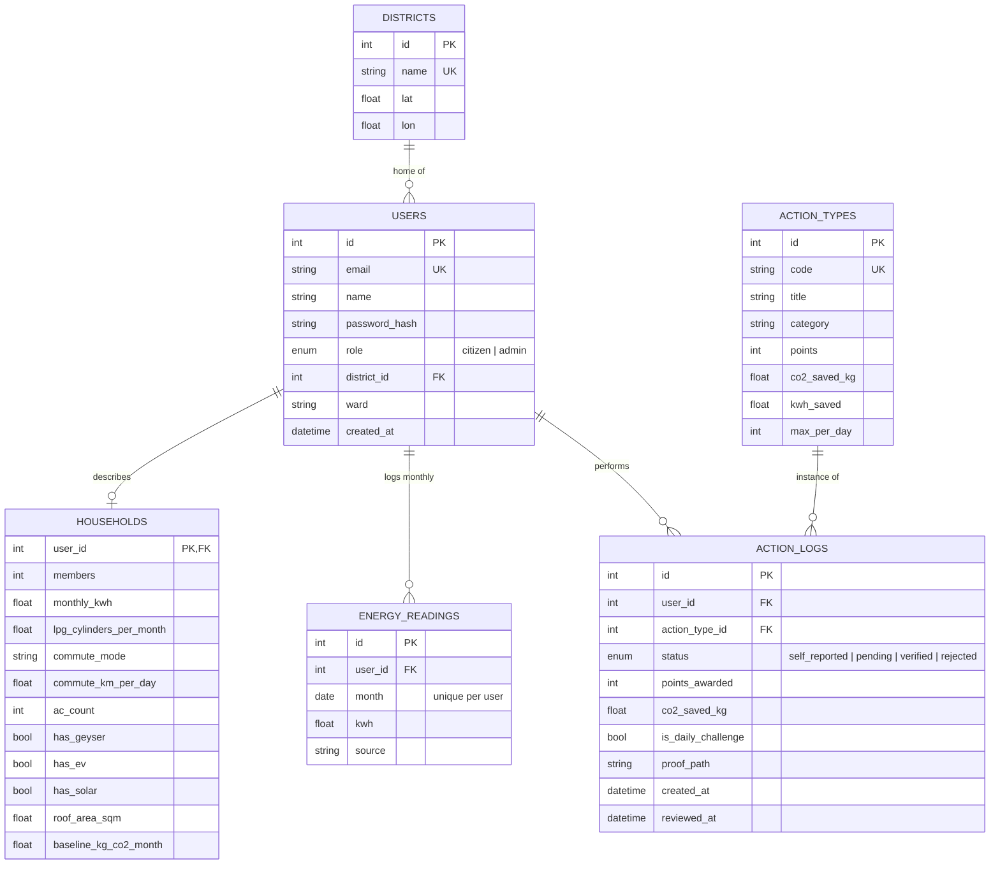

# EcoSetu: Mission LiFE citizen engagement platform

> HackCult '26 · Track 1: Green Energy & Sustainability · Problem statement **HC26-GEDA01** (Gujarat Energy Development Agency)

EcoSetu ("eco bridge") connects Gujarat's climate goals to the decisions people make at home every day. A household finds its carbon baseline in two minutes. After that, the app sends nudges timed to the grid's peak and solar hours and to the local weather. A shared daily challenge and district goals get communities acting together. A rooftop solar calculator uses satellite irradiance data for the user's location. GEDA administrators get a regional view of who is engaged and where the savings come from.

## How it maps to the problem statement

| Expected feature | What EcoSetu does |
|---|---|
| **Personalised footprint tracker** | 3-step onboarding with a live footprint preview (electricity, cooking gas, commute). Monthly bill readings are tracked against the baseline. |
| **Snap your bill** | Photograph the electricity bill and the units fill in automatically. Two-month bills are converted to monthly figures. Claude vision reads it when an API key is configured; otherwise OCR runs on the device and the photo never leaves the phone. |
| **Behavioural nudges & micro-tasks** | A rule engine that uses grid time-of-day windows, the household's appliances, live temperature (Open-Meteo) and month-to-date usage. Each nudge links to an action the user can log in one tap. |
| **Gamification & social impact** | Points, levels and streaks. One daily challenge statewide (2× points). Citizen leaderboards by ward, district or state. District goals set at 10% of participants' combined baseline. |
| **Verified green actions** | Self-reported actions earn 40% of points instantly. Uploading a photo that an admin approves earns 100%. This keeps logging easy while making the leaderboard hard to game. |
| **Actionable resource hub** | Rooftop solar sizing from **PVGIS** irradiance data, with net-metered bill savings, **PM Surya Ghar** subsidy, net cost, payback and 25-year gain. |
| **State administrators** (target beneficiaries) | Admin dashboard: active citizens, CO₂ and kWh saved, weekly trend, impact by category, a district map and table, and a proof review queue. |

## Architecture



**Design choices**

- **Domain logic is pure and unit-tested.** Footprint maths, the nudge rule engine, solar sizing and points rules have no I/O. Routers only load data, call them and shape responses.
- **All emission factors and tariff assumptions live in one file** (`backend/app/services/factors.py`), so every number can be checked and changed in one place.
- **External APIs never block the user.** PVGIS and Open-Meteo calls have tight timeouts and fall back to Gujarat averages; weather is cached for 30 minutes per location.
- **Timezone-correct.** Timestamps are stored in UTC; "today", streaks and daily caps use IST day boundaries.
- **Abuse limits.**
  - Login rate limit per IP and email, so one attacker can't lock out other users; sign-up and bill-scan limits too.
  - Per-action daily caps and image-only uploads of at most 5 MB.
  - Points are calculated on the server, and leaderboards count only self-reported or verified actions.
- **Versioned schema.** Alembic migrations, applied before the API workers start. A test fails if the models and migrations drift apart.
- **Privacy-first bill reading.** Only consumption figures are extracted; bill photos are never stored, and without an AI key they're read entirely in the browser.

## Database schema



Indexes: `action_logs(user_id, created_at)` serves dashboards, streaks and daily caps; `action_logs(status)` serves the review queue.

## Running it

### Quick start (no Docker)

Requirements: Python 3.11+ with [uv](https://docs.astral.sh/uv/), Node 20+.

```bash
# 1. API on :8000, with SQLite and synthetic demo data
cd backend
uv sync
uv run python -m app.seed --demo
uv run uvicorn app.main:app --reload --port 8000

# 2. Web app on :3000 (in a second terminal)
cd frontend
npm install
npm run dev
```

To enable AI bill reading, put `ANTHROPIC_API_KEY=...` in `backend/.env` (see `.env.example`). Without it, bills are read on the device.

Open http://localhost:3000. Demo logins (password `demo1234`):

- `citizen1@ecosetu.demo` – citizen with six months of history
- `admin@ecosetu.demo` – GEDA admin dashboard

Or register a new account to go through onboarding. Interactive API docs: http://localhost:8000/docs

### With Docker (PostgreSQL)

```bash
docker compose up --build
docker compose exec api python -m app.seed --demo   # optional demo data
```

### Tests

| Suite | Command | Covers |
|---|---|---|
| Backend (38 tests) | `cd backend && uv run pytest` | Footprint, tariff, nudge, solar and points rules; every API flow; rate limits; migrations match the models |
| Backend on PostgreSQL | `TEST_DATABASE_URL=postgresql+psycopg://… uv run pytest` | The same suite against Postgres |
| Frontend unit | `cd frontend && npm test` | Bill text parser on realistic OCR output |
| End-to-end | `cd frontend && npm run e2e` | Sign-up → bill scan (real OCR) → actions → leaderboards → solar → profile; admin review; phone layouts |
| Static checks | `npm run lint && npm run typecheck` | ESLint and TypeScript |

GitHub Actions (`.github/workflows/ci.yml`) runs all of these on every push, plus a Docker Compose build and smoke test against PostgreSQL.

## API overview

| Method & path | Purpose |
|---|---|
| `POST /api/auth/register`, `POST /api/auth/login`, `GET /api/auth/me` | JWT auth |
| `POST /api/footprint/preview` | Live footprint calculation (no auth, used by onboarding) |
| `PUT /api/household`, `GET /api/household` | Onboarding answers and baseline |
| `GET/POST /api/readings` | Monthly bill readings vs baseline |
| `POST /api/bills/scan` | Read units from a bill photo (503 when AI isn't configured, so the client reads on-device) |
| `PATCH /api/auth/me` | Update name, district, ward |
| `GET /api/dashboard` | Footprint, points, level, streak, rank, trend, today's challenge |
| `GET /api/nudges` | Contextual nudges for right now |
| `GET /api/actions/types`, `GET /api/actions/today`, `POST /api/actions`, `GET /api/actions/mine` | Action catalogue, daily challenge, logging with optional photo proof |
| `GET /api/leaderboard/users?scope=ward\|district\|state`, `GET /api/leaderboard/districts` | Citizen and district standings |
| `POST /api/solar/estimate` | Rooftop solar sizing, cost, subsidy and payback |
| `GET /api/admin/overview`, `GET /api/admin/reviews`, `POST /api/admin/reviews/{id}` | Admin analytics and proof review |

## Data sources and assumptions

These are approximate defaults, all in `factors.py`. Check them against current publications before production use.

| Value | Default | Source |
|---|---|---|
| Grid emission factor | 0.71 kg CO₂/kWh | CEA CO₂ Baseline Database (weighted average, approx.) |
| LPG | 42.3 kg CO₂ per 14.2 kg cylinder | ~2.98 kg CO₂/kg LPG |
| Residential tariff | Slabs ₹3.05–5.20/kWh + ₹2.85 FPPPA | Illustrative Gujarat DISCOM values |
| Peak / solar windows | 18:00–22:00 / 09:00–17:00 IST | Typical ToD windows |
| Solar yield | Live from PVGIS; fallback 1,550 kWh/kWp/yr | EU JRC PVGIS |
| Solar cost / subsidy | ₹60,000/kWp; ₹30k/kW up to 2 kW + ₹18k for the 3rd kW, cap ₹78k | PM Surya Ghar Muft Bijli Yojana |
| AC set-point saving | ~6% per °C | BEE guidance |

Action savings (for example "Geyser off after use" ≈ 1 kWh) are conservative per-instance estimates.

## Scalability

- **Stateless API.** JWT auth, no server sessions. Scale horizontally behind a load balancer; the Docker image runs multiple Uvicorn workers.
- **Aggregations are grouped SQL queries**, not per-row loops; the admin overview is a fixed number of queries no matter how many districts there are.
- **Next steps at scale:**
  - Redis sorted sets for real-time leaderboards
  - a Redis-backed rate limiter (the current one is per process)
  - materialised daily rollups for admin analytics
  - S3 or object storage with signed URLs for proof images
  - a task queue for scheduled push nudges

## Limitations

- Footprint covers household electricity, cooking gas and commute. Diet, waste and flights are not modelled yet.
- Nudges are rule-based and pulled when the app opens. They are not push notifications.
- Proof review is manual. Tariffs are illustrative rather than pulled from each DISCOM.
- The demo data from `--demo` is synthetic.

## Roadmap

1. Read the tariff category and sanctioned load from the bill too, for exact per-DISCOM bill estimates.
2. Push and WhatsApp nudges at peak-hour start, using each user's chosen times.
3. Smart-meter / DISCOM API integration for verified monthly consumption, removing manual readings.
4. Auto-verification of photo proof (image classification plus EXIF date and location checks), keeping admins for edge cases.
5. A vendor directory with GEDA-empanelled rooftop installers and a one-tap site-survey request.
6. Gujarati and Hindi interfaces.
