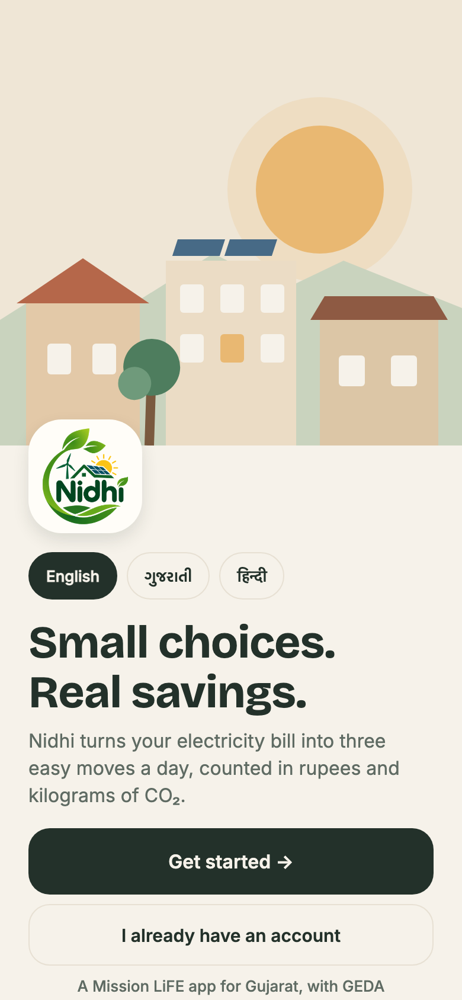
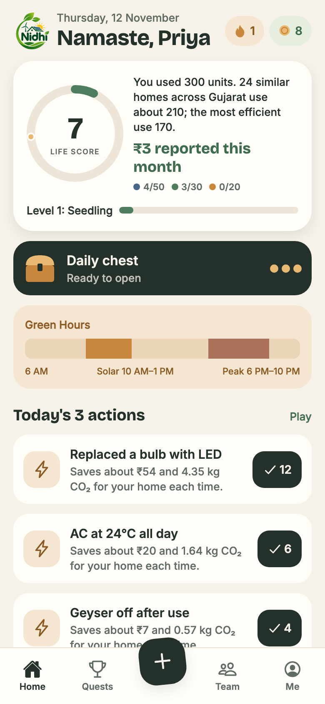
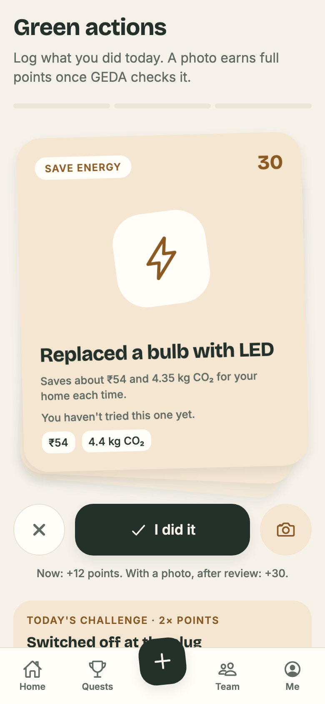
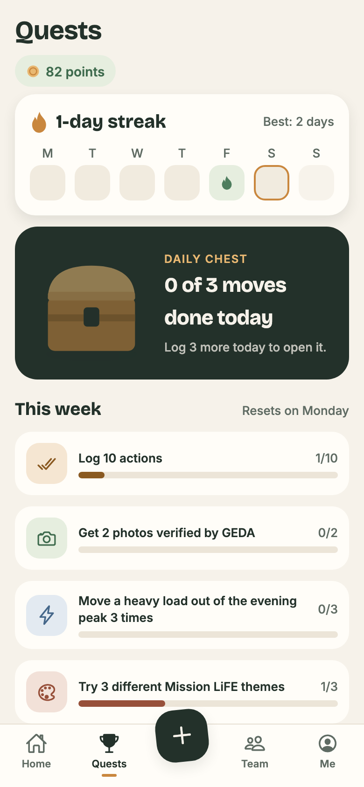
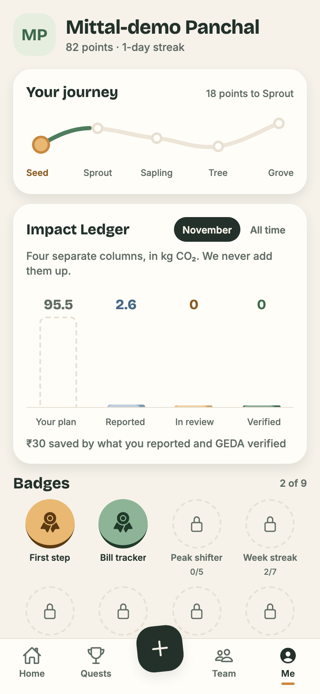
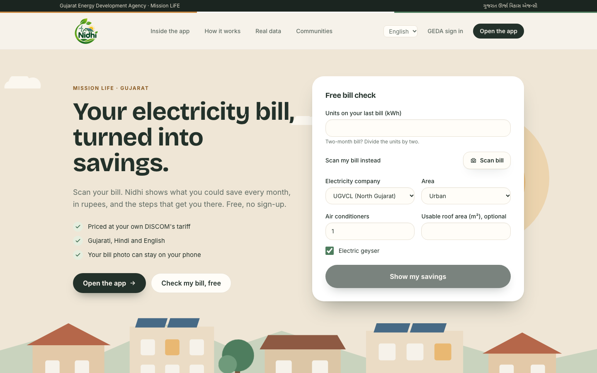
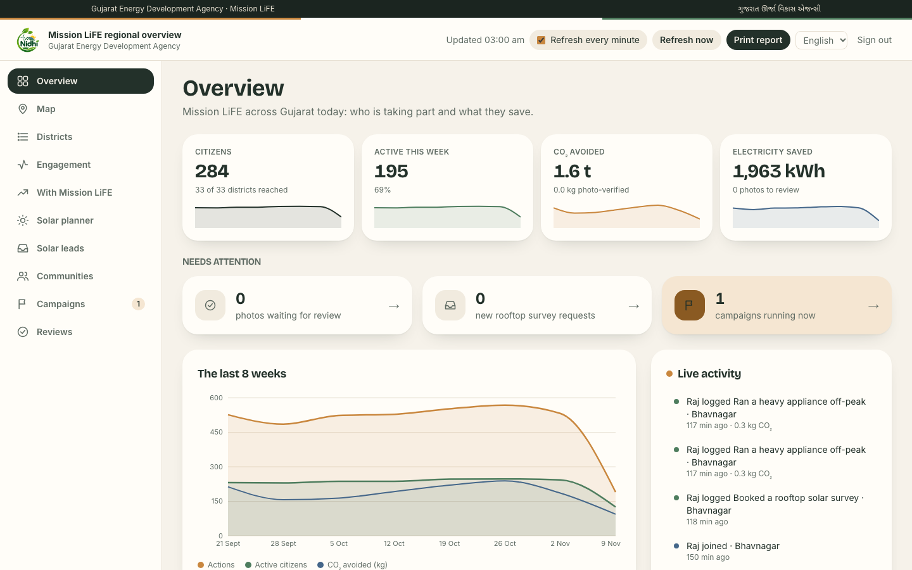
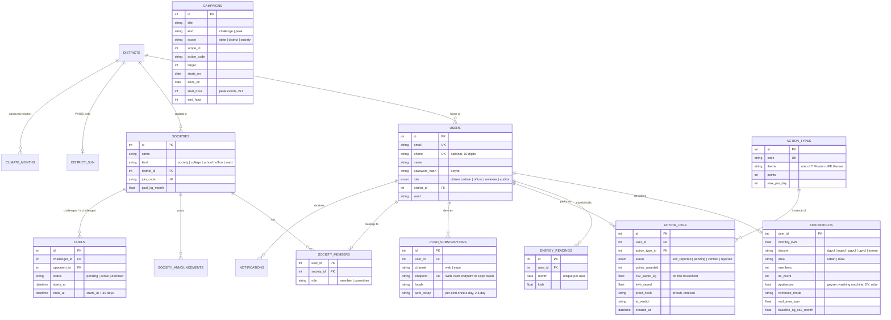

<div align="center">


# Nidhi

### Small choices. Real savings.
**Gujarat's Mission LiFE companion: your electricity bill, turned into three easy moves a day, counted in rupees and kilograms of CO₂.**

[](https://github.com/neevmodh/Nidhi-LiFE/actions/workflows/ci.yml)
[](https://nidhi-gujarat.vercel.app)
[](https://nidhi-app-rosy.vercel.app)


**HackCult '26** · Track 1: Green Energy & Sustainability · Problem statement **HC26-GEDA01**<br/>
Built for the **Gujarat Energy Development Agency (GEDA)** by team **Beyond Logic**

**[Website](https://nidhi-gujarat.vercel.app)** · **[Open the app](https://nidhi-app-rosy.vercel.app)** · [GEDA console](https://nidhi-gujarat.vercel.app/geda) · [API docs](https://lifeline-api-9ox2.onrender.com/docs) · [How we calculate](https://nidhi-gujarat.vercel.app/methodology) · [Design canvas](https://claude.ai/artifact/VdiyAQ5vFcb4wivcsi4vCX)

</div>

---

## Built with

<div align="center">

**Phone and web app**<br/>


**Website and GEDA console**<br/>


**API and data**<br/>


**AI, data sources and services**<br/>


**Hosting, testing and tooling**<br/>


</div>

<details>
<summary><b>Every library and what it does</b></summary>

| Layer | Technology | Used for |
|---|---|---|
| App | **Expo SDK 58**, React Native 0.88, React 19.3, react-native-web | One codebase for Android, iPhone and the web |
| App | **Expo Router** (file-based, `Stack.Protected` guards) | Screens and who may see them: signed out, new household, household, GEDA staff |
| App | **Reanimated 4** + react-native-worklets | Every animation: count-ups, the 3D card deck, the chest, the podium, the coin |
| App | **react-native-svg** | The drawn scenes: sunrise, sprout, chest, score ring, crown |
| App | **TanStack Query 5** | Server data, caching and refresh |
| App | expo-secure-store, expo-image-picker, expo-notifications, expo-haptics, expo-file-system, expo-sharing, expo-localization, expo-status-bar | Token storage, bill and proof photos, push alerts, haptic taps, data export, language, light status bar |
| App | Bricolage Grotesque and Inter (`@expo-google-fonts`), Ionicons | Type and icons |
| Website | **Next.js 16** (App Router), **Tailwind CSS 4** | Landing page, free bill check, GEDA console, methodology |
| Website | **Recharts 3** | Console sparklines, the 8-week trend, district bills and themes |
| Website | Leaflet + react-leaflet, qrcode, **Tesseract.js** | District map, charts, QR to the app, on-device bill reading in the free check |
| API | **FastAPI**, Uvicorn, **Pydantic 2**, pydantic-settings | REST API, validation, settings |
| API | **SQLAlchemy 2**, **Alembic**, psycopg 3 | Models, versioned migrations, PostgreSQL driver |
| API | PyJWT, bcrypt, email-validator | Sessions, passwords, emails |
| API | httpx, Pillow, pywebpush, fpdf2 | Outside data, image checks and photo hashing, Web Push, PDF reports |
| AI | **Groq** vision (Claude as fallback, `anthropic` SDK) | Reading electricity bills; pre-screening proof photos; the weekly coach note |
| Data | **EU JRC PVGIS**, **Open-Meteo**, CEA, IPCC, GERC, BEE, PM Surya Ghar | Solar yield, weather and forecast, emission factors, tariffs, subsidy |
| Language | **Adaption** | Gujarati and Hindi catalogues, with every `{placeholder}` checked |
| Database | **Supabase** PostgreSQL + private Storage | Data, with Row Level Security on every table; proof photos |
| Hosting | **Vercel** (website and app web build), **Render** (API, Docker), **EAS Build** (Android APK) | Production |
| Quality | pytest (SQLite + PostgreSQL), Vitest, Playwright, TypeScript, ESLint, Docker Compose, GitHub Actions | Every pull request |

</details>

---

## Contents

[The app](#the-app) · [Website and console](#website-and-console) · [Why Nidhi](#why-nidhi) · [What it does](#what-it-does) · [The game](#the-game-honest-by-design) · [Design](#design) · [How it meets HC26-GEDA01](#how-it-meets-hc26-geda01) · [Architecture](#architecture) · [Database](#database-schema) · [Honest numbers](#honest-numbers) · [Try it](#try-it) · [Run it locally](#run-it-locally) · [Deploying](#deploying) · [Tests](#tests) · [API](#api-overview) · [Project structure](#project-structure) · [Security and privacy](#security-and-privacy) · [Roadmap](#limitations-and-roadmap)

## The app

<div align="center">
<table>
<tr>
<td align="center"><br/><b>Welcome</b></td>
<td align="center"><br/><b>Home</b></td>
<td align="center"><br/><b>Act</b></td>
<td align="center"><br/><b>Quests</b></td>
<td align="center"><br/><b>Me</b></td>
</tr>
</table>
</div>

The app's web version is fully responsive: a full screen on a 320 px phone, a centred column on tablets and desktops, never a sideways scroll.

## Website and console

<div align="center">

<br/><br/>

</div>

## Why Nidhi

India's **Mission LiFE** asks every household to live more sustainably. Most people agree, but they can't answer three questions:

1. **How am I doing, and how do I compare?** A bill says *540 units*. It doesn't say that's about 380 kg of CO₂, or that similar homes in your district use 400.
2. **What should I do today?** Running the washing machine at 7 PM, at the evening peak, is not the same as at noon, when Gujarat's solar plants are at full output.
3. **Is rooftop solar worth it for me, and who can install it?**

GEDA has the same blind spot at state scale: who is taking part, in which Mission LiFE themes, what is really being saved, and how to move people together.

**Nidhi answers these for households, communities and the state, with real data and honest numbers, and makes it a pleasure to come back every day.**

## What it does

### For households: the Nidhi app (Android, iPhone and web, one Expo codebase)

| | |
|---|---|
| 🌅 **Welcome and sign in** | A drawn sunrise over Gujarati rooftops, the language switched on the spot, then sign up or sign in with your **email or mobile number**. |
| 📸 **A two-minute start** | Photograph the electricity bill: a vision model reads the units and the DISCOM, and the photo isn't kept. Steppers for units, people and ACs; the footprint preview counts up as you answer. |
| 🏠 **Home** | Your **LiFE Score** ring drawing itself in, **homes like yours** in your district, your level, the **daily chest**, today's **Green Hours** as a timeline (solar window, evening peak, now), and the **Action Engine**'s three best moves with one-tap logging. |
| ✅ **Act** | Today's moves as a **3D deck of cards**: log it, skip it, or add a photo. Then every action for your home across the seven Mission LiFE themes, with rupees, CO₂ and points, and the daily challenge at 2×. Logs made offline are sent when the signal returns. |
| 🏆 **Quests** | The week as **streak flames**, a **daily chest** that opens once three actions are logged and shows the day's real totals, four **weekly quests**, and the **prize shelf**. |
| 🏅 **Prizes** | Eight trophies in bronze, silver and gold (first step, seven-day flame, proof pro, peak hero cup, sapling cup, carbon cutter, badge collector, grove crown). Won ones shine on the shelf; the rest show how far along you are. Winning one gets its own celebration. |
| 🎉 **Celebrations** | A whole screen, as in the design: a spinning coin (or trophy) in turning rays, petals and sparks, the points counting up, and a card with your level bar, streak, photo quest and today's points. A photo GEDA approves, and a prize just won, are celebrated next, one at a time. |
| 🏘️ **Team** | Join or start a housing society, college, school, office or ward: a monthly goal, announcements, a **weekly league** with a 3D podium, **30-day duels** as a live tug-of-war, a **map of Gujarat's 33 districts** coloured by progress (tap one for its numbers), district standings and live GEDA campaigns. Totals stay hidden until 5 households join. |
| ⚡ **Peak Hour Challenge** | GEDA schedules evening peak events; you get a reminder 30 minutes before and log the heavy loads you moved. Demand response without payments. |
| 📈 **My progress** | Each month's units against where you started, as bars against a dashed baseline: the change in percent, units and rupees, months in a row below your start and your best month. Add a month by typing it or from a bill photo. |
| 🧾 **Bill X-ray** | Snap your bill and see where the money goes, exactly as your DISCOM charges it: energy by slab, fuel surcharge, duty and fixed charge, which slab your last units fall in, the cut that drops you a slab, and where the units likely go (AC, fridge, lights, geyser…). |
| 🎛️ **What if…** | Set the AC warmer, swap bulbs for LEDs, add rooftop solar, switch the geyser and standby off: the bill, rupees, kg CO₂ and trees a year change as you tap, using your own tariff. |
| 💬 **Ask Nidhi** | Ask anything about your bill, AC, geyser, solar, peak hours, water or travel, in English, ગુજરાતી or हिन्दी, and get an answer from your own home's numbers, with an action to log in one tap. An AI may phrase English answers, but only when every number in them is one of your facts; otherwise, and always in Gujarati and Hindi, reviewed answers are used. |
| 🔔 **Alerts** | What to do right now (peak hours, the solar window, the AC set-point with today's temperature) with one-tap logging, and updates for you (photo decisions, society messages). Works without push notifications. |
| 📤 **Share my month** | Your impact card in the app's design, straight to WhatsApp from Me or any celebration. |
| ☀️ **Solar** | System size from your roof and use, real PVGIS sunshine for your district, savings at your own DISCOM tariff, the PM Surya Ghar subsidy, net cost, payback and 25-year gain, how to apply, and the government's list of registered vendors. |
| 📒 **Me** | Your initials, points and streak; the **journey** as a winding path from Seed to Sprout, Sapling, Tree and Grove; the **Impact Ledger** as four 3D columns (your plan, reported, in review, verified) that are never added together; badges and prizes. **Language, data and account** has its own page: language, download all your data, or delete your account and photos for good. |
| 🌐 **Gujarati and Hindi** | Every screen in English, ગુજરાતી and हिन्दी, including the server's own text (action names, reasons, nudges), fetched again the moment you switch. One word per idea in each language (points is પોઇન્ટ and अंक everywhere), and a test fails if any key is missing or loses a placeholder. |
| 🖥️ **Web, phone and desktop** | On a phone the bottom bar keeps clear of the gesture bar. In a wide browser window the app becomes a desktop app: a sidebar with the language switch, and two-column Home, Quests and Me. |

### For GEDA: the console (web)

| | |
|---|---|
| 📊 **Headline figures, live** | Citizens, active this week, CO₂ avoided and electricity saved, each counting up with an 8-week sparkline; refreshes every minute, with "updated at" and a print-ready report. |
| 📡 **Live activity** | Sign-ups, logged actions and photos as they happen, every 15 seconds. |
| 📈 **The last 8 weeks** | Actions, active citizens and CO₂ avoided, week by week. |
| 🗺️ **The state at a glance** | All 33 districts on a real map (sunshine, citizens, CO₂). |
| 🧮 **Every district** | A sortable, searchable table (citizens, participation, actions, CO₂ per citizen, rooftop potential) with CSV export, and a drill-down per district: bills over time, Mission LiFE themes, top wards, rooftop solar and its subsidy pipeline, and a district CSV. |
| ☀️ **Rooftop solar planner** | Slide the share of suitable registered homes going solar, statewide or per district: capacity, generation, CO₂ avoided, bill savings, subsidy needed and payback, from PVGIS sunshine. |
| 📈 **Funnel and themes** | Registered → set up their home → acted this week → photo-verified; actions and impact by Mission LiFE theme. |
| 🤝 **Communities and duels** | Communities by kind, the top ones this month, and every open duel. |
| 🎪 **Campaigns and peak events** | Create statewide or district campaigns and Peak Hour Challenges from the console, or start from a festival or season (Diwali LED switch, Uttarayan sun days, Summer AC at 24°C week, Monsoon water week). Live campaigns appear on every household's Home. |
| 🔍 **Photo review** | Approve or reject proofs. AI only pre-screens, and reused photos are refused automatically. |
| 🔑 **Roles** | State team, district officer (own district only, enforced by the API), reviewer and read-only auditor. |

### For everyone: the website

A sunrise over Gujarati rooftops behind a free bill check with no sign-up (its answers carry into the app), the app in three phone frames, what is inside it, how it works and the data behind it, a QR code for the Android app, a button to open the app in the browser, the methodology page and the GEDA sign-in. It works from a 320 px phone to a wide desktop.

## The game, honest by design

Nidhi borrows what makes games pleasant to return to (streaks, a daily chest, quests, levels, a team to cheer for) without inventing anything:

- **Points come only from the server's rules.** Logging now earns 40% of an action's points; a photo GEDA verifies earns all of them; the daily challenge pays 2×.
- **Quests, the chest and the streak calendar are worked out from your own history** (`GET /api/actions/mine`), so they never hand out points of their own. The chest reveals what you actually did today.
- **"In a row"** counts consecutive moves without multiplying points.
- **Prizes are worked out the same way**, from points, streak, badges and history the server already counted.
- **Every animation stands still** when the phone's reduce-motion setting is on.

## Design

**Logo.** Leaves wrapping around a home with rooftop solar, a wind turbine and the rising sun, over the name: clean energy at home, growing. It is the app icon (with Android adaptive and monochrome versions), the browser-tab icon, the website and console header, and the welcome, sign-in and home screens.

Nidhi has one look everywhere: **warm paper, deep ink, soft sage and saffron**, with dusty sky and clay for variety. It uses flat colour and soft shadows, no glow or gradients, and small drawn illustrations carry the character. It is always the light design, whatever the phone's dark-mode setting. The approved screens live in the [design canvas](https://claude.ai/artifact/VdiyAQ5vFcb4wivcsi4vCX).

| Token | Colour | Used for |
|---|---|---|
| Paper | `#F6F2EA` | Backgrounds |
| Card | `#FFFDF8` | Cards and sheets |
| Ink | `#23312A` | Text, primary buttons, the chest strip |
| Sage | `#4E7D5E` | Progress, the score ring, verified impact |
| Saffron | `#C9873E` | Streaks, points, Green Hours |
| Sky | `#45678A` | Reported impact, water |
| Clay | `#97503A` | The evening peak, the other side of a duel |

Type: **Bricolage Grotesque** for headings and big numbers, **Inter** for reading, and Noto Sans Gujarati and Devanagari on the website. Motion: Reanimated springs and timings in `mobile/src/components/motion.tsx`.

## How it meets HC26-GEDA01

| The problem statement asks for | Nidhi |
|---|---|
| **Personalised footprint tracker** | Bill-photo onboarding; baseline from electricity, cooking gas and commute; LiFE Score; comparison with similar homes; Impact Ledger over time |
| **Behavioural nudges and micro-tasks** | The Action Engine ranks actions for this home now (season, time, Green Hours, what you've done); push reminders for Green Hours, the evening peak and Peak Hour Challenges; a daily challenge; a daily chest |
| **Gamification and social impact** | Points validated by photo review and duplicate-photo detection; levels, streaks, quests, badges; community leagues, duels and campaigns |
| **Actionable resource hub** | Rooftop solar advisor with PVGIS, PM Surya Ghar subsidy and payback; how to apply; the official vendor list |
| **Beneficiaries** | Households; societies, colleges, schools, offices and wards; GEDA state team and district officers |

## Architecture


- **One source of truth.** The app imports the website's API types and language catalogues (`@shared` → `web/src`), so a change to the API or the wording breaks both or neither. Every factor and its source lives in `backend/app/services/factors.py` and is served at `GET /api/config` and on the methodology page.
- **Domain logic is pure and unit-tested:** footprint, per-household impact, the savings plan, the Action Engine, the LiFE Score, the Impact Ledger, solar sizing, Green Hours and the weather regression have no I/O.
- **Nothing external can block a user.** Every outside service has a timeout and a fallback (Gujarat-average solar yield, no temperature reason, type the units by hand).
- **Timezone-correct:** stored in UTC; days, streaks, caps, duels, quests and peak windows use IST.
- **Versioned schema:** Alembic migrations, a test that fails if models and migrations drift, foreign keys enforced on SQLite too, and every backend test run on both SQLite and PostgreSQL in CI.

## Database schema



Not drawn: `society_announcements`, `notifications`, `climate_months` and `district_sun` (caches of Open-Meteo and PVGIS). Campaigns of scope `state`/`district` belong to GEDA; `society` campaigns to a committee.

## Honest numbers

- **Estimates, reports and verified impact never mix.** The Impact Ledger and the GEDA console keep them apart; rejected actions count nowhere.
- **No invented CO₂.** Plastic, water, food, waste, e-waste and similar actions earn points but show no CO₂, because no defensible per-action figure exists. Electricity, cooking and travel are calculated from each household's own data.
- **Privacy floors.** Communities show totals only from 5 households; duels count a side only from 40% participation; district officers see only their district.
- **Sources for every figure** (CEA grid factor, IPCC LPG, India GHG Program transport, GERC tariffs, PVGIS, PM Surya Ghar, BEE, Opower for peer comparison) are listed with links on the **[How we calculate](https://nidhi-gujarat.vercel.app/methodology)** page, generated from the same code the app runs.

## Try it

| What | Where |
|---|---|
| Website, free bill check, Android QR code | https://nidhi-gujarat.vercel.app |
| The Nidhi app in a browser | https://nidhi-app-rosy.vercel.app |
| GEDA console (staff sign-in) | https://nidhi-gujarat.vercel.app/geda |
| API and interactive docs | https://lifeline-api-9ox2.onrender.com/docs |

The API runs on Render's free tier, which sleeps when idle. A scheduled GitHub Action pings it every 10 minutes to keep it awake, and the app and website retry reads and sign-in while it wakes, so a first sign-in waits instead of failing.

**Demo data.** The live database holds 276 demo households in 8 communities, with 3 duels and a Peak Hour Challenge on 14 November, so the leagues, ledgers and console have something to show. Every demo name carries "ડેમો" (demo) and every demo email is `demo-nidhi-NNN@example.com`. One command removes all of it (below). Everything else comes from real people using the app.

## Run it locally

You need Python 3.12 with [uv](https://docs.astral.sh/uv/), and Node 22.

```bash
# API: creates the database, the 33 districts and the action catalogue
cd backend && uv sync && uv run uvicorn app.main:app --port 8000

# Once: a GEDA administrator (add --district Surat for a district officer)
cd backend && uv run python -m app.create_admin --email you@example.com --name "Your Name"

# Household app (web build; press a / i for Android or iPhone)
cd mobile && npm install && EXPO_PUBLIC_API_URL=http://localhost:8000 npx expo start --web   # http://localhost:8081

# Website and GEDA console
cd web && npm install && NEXT_PUBLIC_API_URL=http://localhost:8000 npm run dev               # http://localhost:3000

# Optional demo data (communities, duels, a peak event), and removing it again
cd backend && DEMO_PASSWORD=choose-one uv run python tools/seed_demo.py --in-process --apply
cd backend && DEMO_PASSWORD=choose-one uv run python tools/seed_demo.py --in-process --remove
```

Or run everything with Docker: `docker compose up --build --wait` (PostgreSQL, API and website).

## Deploying

| Piece | Host | How it ships |
|---|---|---|
| API | Render (`render.yaml`, Docker) | Automatically on every push to `main`. The container runs `alembic upgrade head` on start. |
| Website and GEDA console | Vercel project `lifeline` | `cd web && vercel deploy --prod`. `web/vercel.json` pins the Next.js framework; without it the project falls back to "Other" and serves 404s. |
| App, web version | Vercel project `nidhi-app` | `cd mobile && npm run export:web && cd dist && vercel deploy --prod` |
| App, Android | EAS (`mobile/eas.json`) | `cd mobile && npx eas-cli build -p android --profile preview` gives an installable APK |

Website environment (Vercel, production): `NEXT_PUBLIC_API_URL`, `NEXT_PUBLIC_APP_URL` (the app's web address) and `NEXT_PUBLIC_APK_URL` (the latest APK). The app reads `EXPO_PUBLIC_API_URL` and `EXPO_PUBLIC_CONSOLE_URL` at build time. A new web origin also needs adding to `cors_origin_regex` in `backend/app/config.py`.

Two things that have bitten us:

- **Ship code before migrating the database.** If the live database is migrated to a revision the running API image doesn't have, that image's start-up `alembic upgrade` fails and the API goes down. Merge to `main`, let Render deploy (it migrates on start), and only run migrations by hand when the new code is already live.
- **`npm run export:web`, not bare `expo export`.** Expo puts fonts and icons under `dist/assets/node_modules`, and the Vercel CLI never uploads folders with that name, so the app would sit on a blank screen waiting for fonts. `mobile/scripts/prepare-web-dist.mjs` moves them to `assets/vendor` and writes the SPA rewrite.

## Tests

| Suite | Command | Covers |
|---|---|---|
| Backend (pytest, 319 tests) | `cd backend && uv run pytest` | Footprint, DISCOM bills, per-household impact, plan, Action Engine, LiFE Score, Impact Ledger, community kinds and leagues, duels and the 40% floor, peak events and their window, Web and Expo push (timing, cap, language, dead tokens), duplicate and fake photos, translations (every key in Gujarati and Hindi, placeholders intact), officer scoping, Bill X-ray (the parts add up to the bill for every tariff and slab boundary), Ask Nidhi (invented numbers or actions rejected, model down, Gujarati and Hindi never sent to the model, rate limit), email and mobile-number sign-in, account export and deletion, the demo seeder, every API flow, migrations match models |
| Backend on PostgreSQL | `TEST_DATABASE_URL=postgresql+psycopg://… uv run pytest` | The same suite on Postgres (CI) |
| Web unit (Vitest, 22 tests) | `cd web && npm test` | The on-device bill parser, festival campaign dates, every website, console and app key translated with its placeholders, retrying while the API wakes up (reads and sign-in only, never logging an action twice) |
| App unit (Vitest, 48 tests) | `cd mobile && npm test` | India-time days and weeks, streak flames, weekly quests, the journey stages at each threshold, prizes (exact targets, rejected logs never count, bad numbers treated as zero), progress against the baseline, the bill on the phone equal to the server's to the paisa, the what-if levers, the district map's bands and point-in-district taps, rupee grouping and avatar initials in any script |
| Web end-to-end (Playwright, 6 tests) | `cd web && npm run e2e` | Landing check carries its answers into the app, Get Nidhi links, no dead links, phone layout, GEDA console (funnel, themes, communities, creating a Peak Hour Challenge), staff-only access |
| App | `cd mobile && npx tsc --noEmit && npm run export:web` | Types (including the shared web API types) and a full web build |

GitHub Actions runs all of these on every pull request and push, plus a Docker Compose smoke test with a real sign-up, action and GEDA overview.

## API overview

| Area | Endpoints |
|---|---|
| Auth and profile | `POST /api/auth/register` · `POST /api/auth/login` (email or mobile number) · `GET/PATCH /api/auth/me` · `GET /api/districts` |
| Home, footprint and bills | `PUT/GET /api/household` · `POST /api/footprint/preview` · `POST /api/bills/scan` · `GET/POST /api/readings` · `GET /api/dashboard` · `GET /api/plan` · `POST /api/guest/check` |
| Engine, score and ledger | `GET /api/engine/today` · `GET /api/me/score` · `GET /api/me/ledger` · `GET /api/insights/green-hours` · `GET /api/coach/weekly` |
| Actions | `GET /api/actions/types` · `GET /api/actions/today` · `POST /api/actions` (with optional photo) · `GET /api/actions/mine` · `GET /api/badges` |
| Communities | `POST /api/societies` · `POST /api/societies/join` · `GET /api/societies/mine` · `GET /api/societies/leaderboard?kind=&period=week` · `GET /api/communities/{id}/ledger` · announcements and committee endpoints |
| Duels and campaigns | `POST /api/duels` · `POST /api/duels/{id}/accept\|decline` · `GET /api/duels/mine` · `GET/POST/DELETE /api/campaigns` (including `kind=peak`) |
| Solar | `POST /api/solar/estimate` · `GET /api/sun/districts` |
| Alerts | `POST/DELETE /api/push/subscribe` (Web Push) · `POST/DELETE /api/push/expo` · `POST /api/internal/push/run` (scheduler) |
| Your data | `GET /api/account/export` · `DELETE /api/account` |
| GEDA | `GET /api/admin/overview` · `GET /api/admin/funnel` · `GET /api/admin/themes` · `GET /api/admin/communities` · `GET /api/admin/campaigns` · `GET /api/admin/districts/{id}` (+ `report.csv`) · `GET/POST /api/admin/reviews` |
| Meta | `GET /api/health` · `GET /api/config` (every factor and source) · interactive docs at `/docs` |

## Project structure

```
Nidhi/
├── backend/                 FastAPI service
│   ├── app/routers/         auth · household · actions · engine · me · societies · duels · campaigns
│   │                        coach · push · admin · account · meta …
│   ├── app/services/        factors (every number and source) · footprint · impact · plan · engine
│   │                        score · ledger · solar · green_hours · weather_norm · push · stats …
│   ├── app/locales/         en · gu · hi (server text)
│   ├── migrations/          Alembic
│   ├── tools/               demo seeder, Adaption translation, load test
│   └── tests/               pytest
├── mobile/                  Nidhi app (Expo SDK 58)
│   ├── src/app/             screens: hello (welcome), sign-in, sign-up, onboarding, (tabs)/…
│   ├── src/components/      motion, score ring, chest, podium, journey, illustrations, ui …
│   ├── src/lib/             api, session, game (quests, streak, chest), log-action, queue, storage
│   ├── src/theme/           the paper palette, type and shadows
│   └── scripts/             prepare-web-dist.mjs
├── web/                     Next.js: landing, GEDA console, methodology; shared types and gu/hi catalogues
├── docs/                    ROADMAP, decisions, QA notes, demo script, screenshots
├── render.yaml · docker-compose.yml
└── .github/workflows/       ci.yml · push-alerts.yml
```

## Security and privacy

- **Supabase Row Level Security on every table** with no policies: the public REST API (anon key) sees nothing; only the API's own database role reads and writes. Proof photos are in a **private** bucket, served only to GEDA reviewers.
- bcrypt passwords, JWT sessions (in the phone's secure store on Android and iPhone), CORS limited to the website and the app's web origin.
- Rate limits on login, sign-up and bill scans; uploads are decoded to prove they're real images, with size limits.
- Privacy by default: bill photos aren't stored; committees see first names and action counts only; community figures need 5 households; account deletion removes the account, history and photos.

## Limitations and roadmap

- Alerts: the API sends Green Hours, peak and Peak Hour Challenge reminders through Expo push and Web Push. The Android APK registers its push token, but delivery on Android also needs a Firebase (FCM) key uploaded to EAS; until then reminders reach no one. The web version of the app doesn't get them.
- Mobile-number sign-in uses a password; one-time codes by SMS are next.
- The footprint covers electricity, cooking gas and commute; diet, waste and flights are next.
- The Torrent Power tariff is from published summaries until checked against the GERC schedule.
- A person approves every proof; next is EXIF date and location checks alongside the AI pre-screen.
- Gujarati and Hindi are machine-translated and need a native speaker's review before wide release.
- Next: DISCOM smart-meter data in place of manual readings, and WhatsApp alerts.

---

<div align="center">

Built for **HackCult '26** · Mission LiFE · Gujarat Energy Development Agency<br/>
District boundaries © geoBoundaries (ODbL) · Solar data © EU JRC PVGIS · Weather by Open-Meteo · Base map © Esri

</div>
