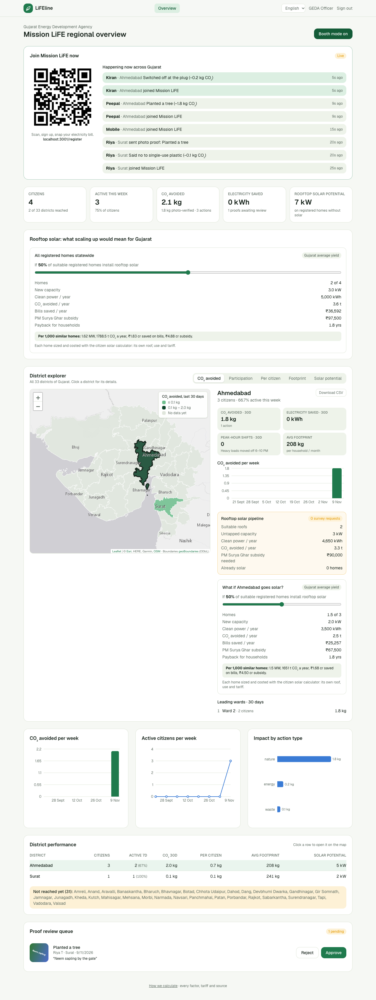
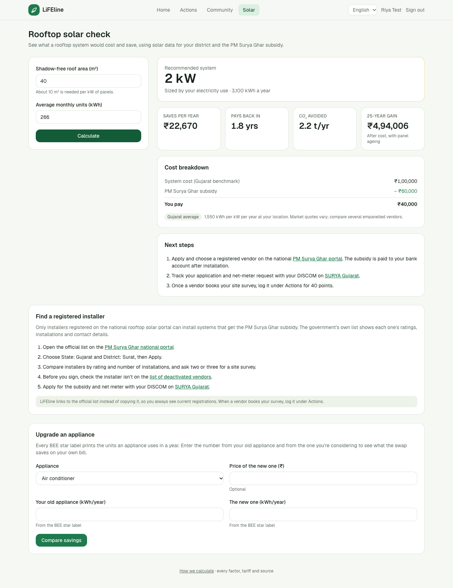
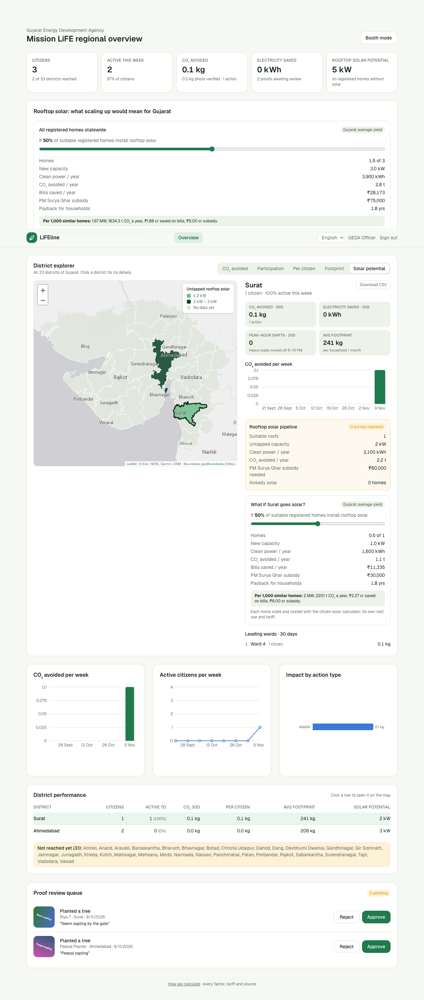
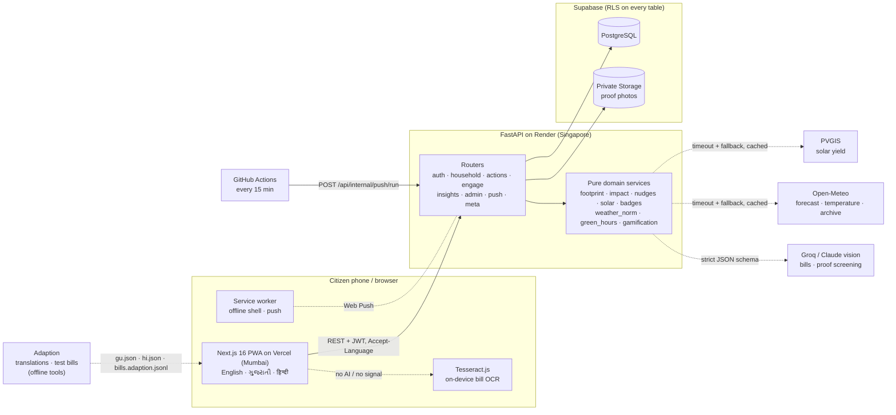
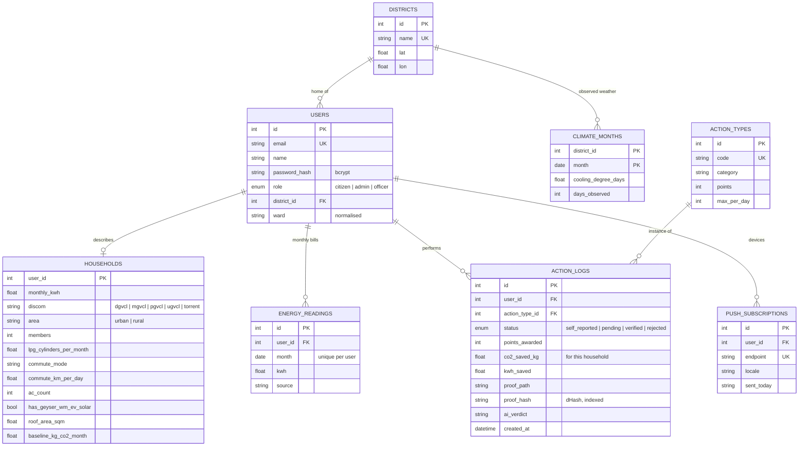

<div align="center">

# 🌱 LiFEline

### Small daily choices, measured. Gujarat's Mission LiFE companion.

[](https://github.com/neevmodh/LiFEline/actions/workflows/ci.yml)
[](https://lifeline-cyan-rho.vercel.app)


**HackCult '26** · Track 1: Green Energy & Sustainability · Problem statement **HC26-GEDA01**<br/>
Built for the **Gujarat Energy Development Agency (GEDA)**

**[Open the live app](https://lifeline-cyan-rho.vercel.app)** · [API health](https://lifeline-api-9ox2.onrender.com/api/health) · [How we calculate](https://lifeline-cyan-rho.vercel.app/methodology)



</div>

## Why LiFEline

India's **Mission LiFE** asks every household to live more sustainably. Most people agree, but they still can't answer three questions:

1. **What is my footprint, and is it falling?** A bill says *540 units*. It doesn't say that's about 380 kg of CO₂, or whether last month's drop was a real saving or just cooler weather.
2. **What should I do right now?** Running the washing machine at 7 PM, at the grid's evening peak, is not the same as running it at noon, when Gujarat's solar plants are at full output. Nobody tells you which hour you're in.
3. **Is rooftop solar worth it for me, and who can install it?**

GEDA has the same blind spot at state scale: which districts are engaged, what is really being saved, and where rooftop solar would pay off.

**LiFEline answers these questions for citizens and for the state, in one app, using only real data.**

## Highlights

| | |
|---|---|
| 📸 **Snap your bill** | Photograph an electricity bill and the units, billing days and amount fill themselves in. A vision model reads it in about a second; without signal or an AI key, it's read on the phone and the photo never leaves it. The on-device reader gets the units right on **254 of 254** test bills across every DISCOM. |
| 🧮 **Savings for your home** | Every action's saving is worked out from your household: "bus instead of car" uses your commute, the AC set-point your number of ACs. Actions that don't fit your home are switched off. Bills use your own DISCOM's GERC tariff. |
| 🌡️ **Real savings, not weather** | A cooler month isn't a saving. Your bills are fitted against observed heat in your district, so you see how far you came in under what the weather alone predicts. |
| ☀️ **Green Hours** | The cleanest hours to run heavy appliances today and tomorrow, from the real hourly solar forecast for your district. Cloudy days move the window. |
| 🔔 **Alerts** | Phone notifications when Green Hours start and 30 minutes before the evening peak. At most two a day, in your language, even with the app closed. |
| 🏆 **Act together** | One daily challenge for all of Gujarat, ward, district and state leaderboards, district goals on a real map, eight badges and a shareable impact card. |
| ✅ **Honest points** | Logging is instant (40% of points). A photo approved by GEDA earns the rest. Each photo is fingerprinted, so the same picture, even resized, can't back two claims, and AI pre-screens photos for reviewers. |
| 🧰 **Resource hub** | Rooftop solar sizing with live PVGIS yield and the PM Surya Ghar subsidy; the government's district-wise list of registered installers; and an appliance upgrade calculator using the kWh on your own BEE star labels. |
| 🗺️ **A state view for GEDA** | All 33 districts on a real map. Each district shows engagement, consumption trend, leading wards, a rooftop solar what-if simulator and a CSV report. **District officers** see only their own district. |
| 📱 **Booth mode** | A QR code on the GEDA screen. Sign up on your own phone and watch Gujarat's map and feed update within seconds. |
| 🌐 **Gujarati and Hindi** | The whole citizen app in English, ગુજરાતી and हिन्दी, translated with Adaption, with every placeholder checked. |
| 📲 **Installs like an app** | Add to home screen, works on patchy networks, and actions logged offline are sent when the signal returns. |

## Try it

**Live:** open **https://lifeline-cyan-rho.vercel.app**, sign up, and scan your electricity bill. On a phone, use *Add to Home Screen* to install it.

There is **no sample or synthetic data**. Every citizen, reading and action comes from a real person using the app. Every factor and tariff is listed with its source on the **[How we calculate](https://lifeline-cyan-rho.vercel.app/methodology)** page.

**Locally** (Python 3.11+ with [uv](https://docs.astral.sh/uv/), Node 20+):

```bash
# API: creates the database, the 33 districts and the action catalogue
cd backend && uv sync && uv run uvicorn app.main:app --port 8000

# Once: a GEDA administrator (add --district Surat for a district officer)
cd backend && uv run python -m app.create_admin --email you@example.com --name "Your Name"

# Web app
cd frontend && npm install && npm run dev      # http://localhost:3000
```

## Tour

### For citizens

<table>
  <tr>
    <td width="50%" valign="top">
      
      <p><b>Snap your bill.</b> A two-month bill of 540 units becomes 266 kWh a month, and the footprint and bill (at your DISCOM's tariff) update as you answer.</p>
    </td>
    <td width="50%" valign="top">
      
      <p><b>Your dashboard.</b> Today's statewide challenge, nudges for right now, Green Hours, your footprint over time against your baseline, badges and weather-adjusted savings.</p>
    </td>
  </tr>
  <tr>
    <td valign="top">
      
      <p><b>Green actions.</b> Twelve actions with savings worked out for your home; actions that don't apply are switched off. Add a photo for full points.</p>
    </td>
    <td valign="top">
      
      <p><b>Community.</b> Ward, district and state leaderboards, and every district's progress towards its monthly goal on a real map.</p>
    </td>
  </tr>
  <tr>
    <td valign="top">
      
      <p><b>Resource hub.</b> Rooftop solar sizing, cost, subsidy and payback; the official registered-installer list for your district; and an appliance upgrade calculator.</p>
    </td>
    <td valign="top" align="center">
      
      <p><b>Built for phones</b>: bottom tab bar, camera for bills, installable, works offline.</p>
    </td>
  </tr>
</table>

### For GEDA



- **District explorer:** colour all 33 districts by CO₂ avoided, participation, CO₂ per citizen, average footprint or untapped rooftop solar. Each district shows its engagement, heavy loads moved off peak, whether household consumption is falling, leading wards and its rooftop solar pipeline.
- **Solar what-if:** "if 50% of suitable registered homes went solar" gives MW, clean power, CO₂, bills saved and the PM Surya Ghar subsidy needed, plus a rate per 1,000 homes. Every home is costed with the same calculator citizens use.
- **Proof review queue** with an AI pre-screen ("looks genuine", "looks unrelated") and a confidence score; a person always decides.
- **CSV report** per district, **booth mode**, and **district officer** accounts scoped to one district.

## How it meets the problem statement

| HC26-GEDA01 asks for | LiFEline |
|---|---|
| **Personalised footprint tracker:** streamlined onboarding, baseline, improvement over time | Three-step onboarding with bill scan and live preview; baseline from electricity, cooking gas and commute; monthly footprint-over-time chart against the baseline; weather-adjusted real savings |
| **Behavioural nudges and micro-tasks:** contextual alerts (e.g. peak-hour shifting), daily challenges | Rule-based nudges using peak hours, the live solar forecast, today's temperature and your appliances; push alerts at the start of Green Hours and before the evening peak; one daily challenge statewide at 2× points |
| **Gamification and social impact:** leaderboards, local goals, points that validate green actions | Ward, district and state leaderboards; district goals at 10% of participants' baseline; points with photo verification, duplicate-photo detection and AI pre-screening; levels, streaks, badges, a shareable impact card |
| **Actionable resource hub:** rooftop solar feasibility or a vendor directory | Both: PVGIS-based solar calculator with PM Surya Ghar subsidy and Gujarat benchmark cost, and the government's district-wise registered installer list, plus an appliance upgrade calculator |
| **Beneficiaries:** residential consumers, local communities, state administrators | Citizens; wards and districts; GEDA state team and district officers |
| **Suggested stack:** React/Next, FastAPI, PostgreSQL, weather and maps APIs | Next.js 16, FastAPI, Supabase PostgreSQL, Open-Meteo (forecast, temperature, history), PVGIS, Leaflet with real district boundaries |

## AI and data science, and what each is for

| Piece | What it does | How it's kept honest |
|---|---|---|
| **Bill reading** (vision model) | Groq (Qwen vision) or Claude reads units, days and amount from a bill photo into a strict JSON schema | Falls back to on-device OCR (Tesseract.js) with a parser tested on **254 Adaption-generated bills**: units **100%**, days 95%, amount 92% (it scored 7% on units before tuning) |
| **Photo pre-screening** (vision model) | Says whether a proof photo plausibly shows the claimed action | Never approves anything; a GEDA reviewer decides |
| **Duplicate photos** (perceptual hash) | 64-bit difference hash; a photo within 4 bits of a live claim's photo is refused | Catches resized and re-compressed copies; tested |
| **Weather-adjusted savings** (regression) | kWh = base load + slope × cooling degree days, per household, from observed weather in its district | Falls back to a district, then state, pooled slope; negative slopes clipped; hand-computed tests on real Surat weather |
| **Green Hours** (forecast) | Sunniest 3-hour window outside the evening peak from the hourly solar radiation forecast | Pure function, tested on clear and cloudy days |
| **Adaption** | Translated 401 strings into Gujarati and Hindi; invented 300 OCR-style Gujarat bills to test the bill reader | Translations kept only if placeholders match; generated bills kept only if their stated answer is found in their own text |

## Real data and sources

Every figure lives in [`backend/app/services/factors.py`](backend/app/services/factors.py) with its source, and the app serves the same list at `GET /api/config` and on its **How we calculate** page, so the documentation can't drift from the code.

| Value | Figure | Source |
|---|---|---|
| Grid emission factor | 0.710 kg CO₂/kWh; peak-hour operating margin 0.964 | CEA CO₂ Baseline Database v21.0, FY 2024-25 |
| Commute | car 0.140, scooter 0.0368 kg/km; city bus 0.0152, metro 0.031 kg per passenger-km | [India GHG Program](https://indiaghgp.org/sites/default/files/Road%20Transport%20Technical%20Paper.pdf), India Specific Road Transport Emission Factors (2015, with uplift); metro derived from Delhi Metro energy and ridership |
| Cooking gas | 42.3 kg CO₂ per 14.2 kg LPG cylinder | IPCC 2006 |
| Tariffs | State DISCOMs urban ₹3.05 / 3.50 / 4.15 / 5.20, rural ₹2.65 / 3.10 / 3.75 / 4.90 per unit, plus fixed charge, FPPAS ₹2.45/unit and electricity duty (15% urban, 7.5% rural); Torrent Power ₹3.20 / 3.95 / 5.00 (being checked against GERC) | GERC tariff schedules effective 1 April 2026 |
| Solar yield | Live per district; fallback 1,550 kWh/kWp/yr | EU JRC PVGIS 5.2 |
| Solar cost and subsidy | ₹50,000/kW up to 2 kW, ₹45,000 above; subsidy ₹30k/kW for 2 kW + ₹18k for the 3rd, cap ₹78k | Government of Gujarat benchmark; PM Surya Ghar: Muft Bijli Yojana |
| Weather | Hourly solar radiation forecast, current temperature, daily history | Open-Meteo (forecast and ERA5 archive) |
| AC set-point | 6% per °C, 24°C default | Bureau of Energy Efficiency |
| Installers | District-wise registered vendors, linked not copied | MNRE PM Surya Ghar national portal |
| Districts | All 33, real boundaries | [geoBoundaries](https://www.geoboundaries.org) IND ADM2 (ODbL) |

Three small actions (single-use plastic, water, a sapling's first year) use fixed estimates, and the methodology page says so.

## Architecture



- **Domain logic is pure and unit-tested:** footprint, per-household impact, nudges, solar sizing, badges, the weather regression and the Green Hours picker have no I/O.
- **Nothing external can block a user.** Every outside service has a timeout and a fallback: Gujarat-average solar yield, no temperature tip, on-device OCR, unscreened proof.
- **Timezone-correct:** stored in UTC; days, streaks, caps and alerts use IST.
- **Versioned schema:** Alembic migrations run before the workers start, and a test fails if models and migrations drift. CI runs every test on SQLite and PostgreSQL.

## Database schema



## Security and privacy

- **Supabase Row Level Security on every table** with no policies: the public REST API (anon key) sees nothing. Only the API's own database role reads and writes. Proof photos are in a **private** bucket and are served only to GEDA reviewers.
- bcrypt passwords (72-byte limit enforced), JWT sessions; CORS limited to the web app.
- Rate limits on login (per IP and email), sign-up and bill scans, with real client IPs behind Render's proxy.
- Uploads are decoded to prove they're real images (no fake or blank files); 5 MB and 50 MP limits.
- Security headers: `nosniff`, `X-Frame-Options: DENY`, strict referrer and permissions policies.
- Privacy by default:
  - bill photos aren't stored
  - the booth feed and share card show a first name and district only
  - district officers see only their own district
  - secrets never live in the repo (`backend/.env` is git-ignored; deploy scripts read it locally)

## Performance and scalability

Measured with Locust against the live free tier (`backend/tools/loadtest.py`, read-only endpoints), from India to Render Singapore and Supabase Seoul:

| Concurrent users | Requests in 60 s | Failures | Median | 95th percentile | Throughput |
|---|---|---|---|---|---|
| 50 | 1,340 | 0 | 130 ms | 400 ms | 22.6 req/s |
| 100 | 2,559 | 0 | 130 ms | 400 ms | 43.3 req/s |

The first run found `/api/districts` at 1.9 s (p95), a database round trip for data that never changes. Caching it in memory and in browsers took it to 160 ms.

- **Stateless API** (JWT), so it scales horizontally. Aggregations are grouped SQL, a fixed number of queries whatever the number of districts. External data is cached per district (forecast 1 hour, weather history permanently for completed months).
- **At larger scale:** Redis for leaderboards and rate limits, materialised daily rollups for GEDA analytics, a queue for push fan-out.

## Tests

| Suite | Command | Covers |
|---|---|---|
| Backend: **136** | `cd backend && uv run pytest` | Footprint, DISCOM bills, per-household impact, weather regression and climate cache, Green Hours, nudges, solar and what-if, badges, push alerts (timing, daily cap, language, expired devices, secret), duplicate and fake photos, wards, translations, officer scoping, every API flow, migrations match models |
| Backend on PostgreSQL | `TEST_DATABASE_URL=postgresql+psycopg://… uv run pytest` | The same suite on Postgres (CI) |
| Frontend unit: **7** | `cd frontend && npm test` | Bill parser, plus accuracy on 254 Adaption-generated bills (fails below 95%) |
| End-to-end: **4** | `cd frontend && npm run e2e` | Sign-up → bill scan (real OCR) → actions with photo → reused photo refused → community map → solar, installers and appliance calculator → profile; GEDA explorer and proof review; phone layout; booth mode live feed. Users are created through the app; nothing is seeded. |

GitHub Actions runs all of them on every push, plus a Docker Compose smoke test.

## Setup in detail

<details>
<summary><b>Docker (PostgreSQL)</b></summary>

```bash
docker compose up --build --wait
docker compose exec api python -m app.create_admin --email you@example.com --name "Your Name"
```
</details>

<details>
<summary><b>Deploy: Vercel + Render + Supabase</b></summary>

- **Supabase:**
  - Create a project and a **private** Storage bucket `proofs`.
  - In `backend/.env`, set `DATABASE_URL` to the transaction pooler (port 6543) and `MIGRATION_DATABASE_URL` to the session pooler (port 5432), both with the `postgresql+psycopg://` prefix.
  - Also set `STORAGE_BACKEND=supabase`, `SUPABASE_URL` and `SUPABASE_SERVICE_KEY`. `scripts/set_supabase_secrets.py` takes the password and key with hidden input.
  - Migrations enable Row Level Security on every table.
- **Render (API):**
  - Use `render.yaml`, or `render services create` (Docker, `backend/`, health check `/api/health`).
  - `scripts/push_render_secrets.py srv-… https://your-site` copies the secrets from `.env` and sets the allowed origin.
- **Vercel (web):** from `frontend/`, set `NEXT_PUBLIC_API_URL` to the Render URL, then `vercel deploy --prod`.
- **Push alerts:**
  - `scripts/setup_push.py srv-…` generates VAPID keys and the scheduler secret, then sets them on Render, in `.env` and as GitHub secrets.
  - `.github/workflows/push-alerts.yml` runs every 15 minutes.
</details>

<details>
<summary><b>Configuration</b></summary>

| Variable | Default | Purpose |
|---|---|---|
| `DATABASE_URL` / `MIGRATION_DATABASE_URL` | SQLite / none | App connection, and the one used for migrations when the app uses a pooler |
| `JWT_SECRET` | dev value | **Set a long random secret in production** |
| `CORS_ORIGINS` | `["http://localhost:3000"]` | Allowed web origins |
| `STORAGE_BACKEND`, `UPLOAD_DIR` | `local`, `uploads` | `supabase` keeps proof photos in a private bucket |
| `SUPABASE_URL`, `SUPABASE_SERVICE_KEY`, `SUPABASE_BUCKET` | none, none, `proofs` | Supabase Storage (server-side only) |
| `GROQ_API_KEY` / `ANTHROPIC_API_KEY` | none | AI bill reading and proof screening (Groq first) |
| `VAPID_PUBLIC_KEY`, `VAPID_PRIVATE_KEY`, `VAPID_SUBJECT`, `PUSH_CRON_SECRET` | none | Web Push alerts and the scheduler secret |
| `ENABLE_EXTERNAL_APIS` | `true` | `false` runs fully offline with documented defaults |
| `FORWARDED_ALLOW_IPS` | `127.0.0.1` | Trust the host's proxy so rate limits see real client IPs |
| `ADAPTION_API_KEY` | none | Only for the translation and test-bill tools |
| `NEXT_PUBLIC_API_URL` (web) | `http://localhost:8000` | API address for the web app |
</details>

<details>
<summary><b>Translations and test bills with Adaption</b></summary>

```bash
cd backend
uv run --with adaption python tools/translate_with_adaption.py --missing --run   # new strings → gu, hi
uv run --with adaption python tools/invent_bill_tests.py --run                    # generated bill test set
```
Each translation is matched back by id and script and kept only if its `{placeholders}` match; `translations.meta.json` records the Adaption runs and whether a native speaker has reviewed them.
</details>

## API overview

| Area | Endpoints |
|---|---|
| Auth and profile | `POST /api/auth/register` · `POST /api/auth/login` · `GET/PATCH /api/auth/me` · `GET /api/districts` |
| Footprint and bills | `POST /api/footprint/preview` · `PUT/GET /api/household` · `GET/POST /api/readings` · `POST /api/bills/scan` · `GET /api/footprint/history` · `GET /api/dashboard` |
| Insights | `GET /api/nudges` · `GET /api/insights/green-hours` · `GET /api/insights/weather` |
| Actions and community | `GET /api/actions/types` · `GET /api/actions/today` · `POST /api/actions` · `GET /api/actions/mine` · `GET /api/badges` · `GET /api/leaderboard/users` · `GET /api/leaderboard/districts` · `GET /api/share/card.png` |
| Resource hub | `POST /api/solar/estimate` · `POST /api/appliances/compare` |
| Alerts | `GET /api/push/key` · `POST/DELETE /api/push/subscribe` · `POST /api/internal/push/run` (scheduler) |
| GEDA | `GET /api/admin/overview` · `GET /api/admin/districts/{id}` · `GET /api/admin/districts/{id}/report.csv` · `GET /api/admin/solar-scenario` · `GET /api/admin/activity` · `GET/POST /api/admin/reviews` |
| Meta | `GET /api/health` (database, storage, AI, external data) · `GET /api/config` (every factor and source) · interactive docs at `/docs` |

## Project structure

```
LiFEline/
├── backend/                 FastAPI service
│   ├── app/routers/         auth · household · actions · engage · insights · admin · push · meta
│   ├── app/services/        factors (every number and source) · footprint · impact · nudges · solar
│   │                        green_hours · weather_norm · climate · badges · gamification · bill_scan
│   │                        proof_screen · share_card · push · stats
│   ├── app/locales/         en · gu · hi (server text)
│   ├── migrations/          Alembic
│   ├── scripts/             create admin, deploy secrets, push setup (run by the owner)
│   ├── tools/               Adaption translation and test-bill pipelines, load test
│   └── tests/               pytest
├── frontend/                Next.js app (PWA)
│   ├── src/app/             landing · login/register · (citizen)/… · admin · methodology
│   ├── src/components/      dashboard cards, map, charts, bill scanner, booth panel, calculators
│   ├── src/i18n/            en · gu · hi
│   ├── src/lib/             API client, bill parser (+ Adaption test bills), offline queue
│   ├── public/              service worker, icons, Gujarat boundaries
│   └── e2e/                 Playwright
├── render.yaml · docker-compose.yml
└── .github/workflows/       ci.yml · push-alerts.yml
```

## Limitations and roadmap

- The footprint covers electricity, cooking gas and commute; diet, waste and flights are next.
- The Torrent Power tariff is from published summaries until checked against the GERC schedule. Fixed charges assume a single-phase connection up to 2 kW.
- A person approves every proof; next is EXIF date and location checks alongside the AI pre-screen.
- Next: DISCOM smart-meter data in place of manual readings, WhatsApp alerts, and native-speaker review of every Gujarati and Hindi string.
- The production base map should move to a licensed or self-hosted tile service.

---

<div align="center">

Built for **HackCult '26** · Mission LiFE · Gujarat Energy Development Agency<br/>
District boundaries © geoBoundaries (ODbL) · Solar data © EU JRC PVGIS · Weather by Open-Meteo · Base map © Esri

</div>
