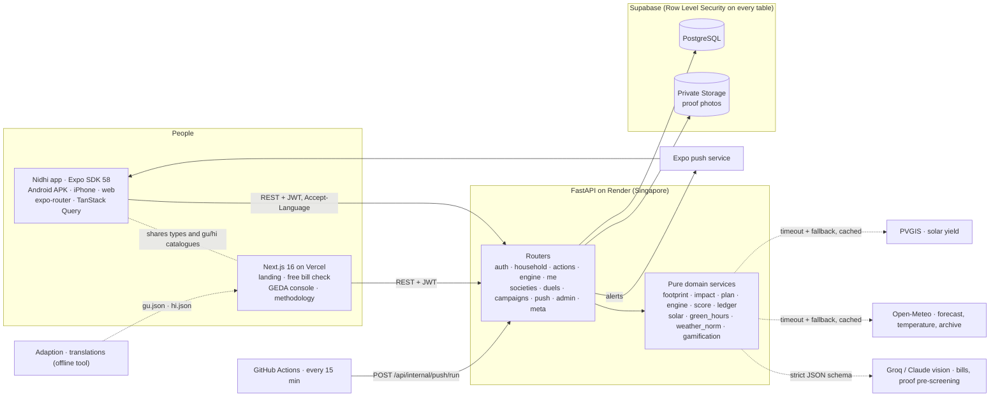

<div align="center">

# 🌱 Nidhi

### Small daily choices, measured. Gujarat's Mission LiFE companion.

[](https://github.com/neevmodh/Nidhi-LiFE/actions/workflows/ci.yml)
[](https://nidhi-gujarat.vercel.app)


**HackCult '26** · Track 1: Green Energy & Sustainability · Problem statement **HC26-GEDA01**<br/>
Built for the **Gujarat Energy Development Agency (GEDA)**

**[Website](https://nidhi-gujarat.vercel.app)** · **[Open the app](https://nidhi-app-rosy.vercel.app)** · [GEDA console](https://nidhi-gujarat.vercel.app/geda) · [API health](https://lifeline-api-9ox2.onrender.com/api/health) · [How we calculate](https://nidhi-gujarat.vercel.app/methodology)

</div>

## Why Nidhi

India's **Mission LiFE** asks every household to live more sustainably. Most people agree, but they can't answer three questions:

1. **How am I doing, and how do I compare?** A bill says *540 units*. It doesn't say that's about 380 kg of CO₂, or that similar homes in your district use 400.
2. **What should I do today?** Running the washing machine at 7 PM, at the evening peak, is not the same as at noon, when Gujarat's solar plants are at full output.
3. **Is rooftop solar worth it for me, and who can install it?**

GEDA has the same blind spot at state scale: who is taking part, in which Mission LiFE themes, what is really being saved, and how to move people together.

**Nidhi answers these for households, communities and the state, with real data and honest numbers.**

## What it does

**For households: the Nidhi app** (Android, iPhone and web, one Expo codebase)

| | |
|---|---|
| 🌅 **Welcome and sign in** | A drawn sunrise over Gujarati rooftops, the language switched on the spot, then sign up or sign in with your **email or mobile number**. |
| 📸 **A two-minute start** | Photograph the electricity bill: a vision model reads the units and the DISCOM. The district suggests the DISCOM when there's no photo, and the footprint preview counts up as you answer (steppers for units, people and ACs). |
| 🏠 **Home** | Your **LiFE Score** out of 100, **homes like yours** (similar size and ACs in your district), the **Action Engine**'s three best actions for today with their reasons and one-tap logging, your streak, a **Nidhi tree** that grows only with photo-verified impact, today's **Green Hours** as a day timeline (solar window, evening peak, now), and the daily chest. |
| ✅ **Act** | Today's three moves as a deck of cards to log, skip or photograph, then every action for your home across the seven Mission LiFE themes, with rupees, CO₂ and points. Log now for 40% of the points, or add a photo for all of them after GEDA reviews it. A daily challenge at 2×, levels and badges. Logs made offline are sent when the signal returns. |
| 🏘️ **Community** | Join or start a housing society, college, school, office or ward. A monthly goal, announcements, a **weekly league** in your district, **30-day duels** with other communities, district standings and live GEDA campaigns. Totals stay hidden until 5 households join. |
| ⚡ **Peak Hour Challenge** | GEDA schedules evening peak events; you get a reminder 30 minutes before and log the heavy loads you moved. Demand response without payments. |
| ☀️ **Solar** | System size from your roof and use, real PVGIS sunshine for your district, savings at your own DISCOM tariff, the PM Surya Ghar subsidy, net cost, payback and 25-year gain, how to apply in Gujarat, and the government's list of registered vendors. |
| 🏆 **Quests** | The week as streak flames, a **daily chest** that opens once three actions are logged and shows the day's real totals, four weekly quests, and badges. Worked out from your own history, so it never invents points. |
| 🎉 **Celebrations** | Every log ends with a spinning coin, sparks and the points counting up; a photo GEDA approves is celebrated the next time you open the app. All motion stops under the phone's reduce-motion setting. |
| 📒 **Me** | Your level journey (Seedling to LiFE Champion) and the **Impact Ledger**: what your plan says is possible, what you reported, what's awaiting review and what GEDA verified, never added together, by theme. Badges, language, and your data: download all of it as JSON, or delete your account and photos for good. |
| 🌐 **Gujarati and Hindi** | Every screen in English, ગુજરાતી and हिन्दी, translated with Adaption, with every `{placeholder}` checked. |

**For GEDA: the console** (web)

| | |
|---|---|
| 🗺️ **The state at a glance** | All 33 districts on a real map (sunshine, citizens, CO₂), each with engagement, consumption trend, wards, rooftop solar potential and a CSV report. |
| 📈 **Funnel and themes** | Registered → set up their home → acted this week → photo-verified; actions and impact by Mission LiFE theme. |
| 🤝 **Communities and duels** | Communities by kind, the top ones this month, and every open duel. |
| 🎪 **Campaigns and peak events** | Create statewide or district campaigns and Peak Hour Challenges from the console. |
| 🔍 **Photo review** | Approve or reject proofs. AI only pre-screens, and reused photos are refused automatically. |
| 🔑 **Roles** | State team, district officer (own district only, enforced by the API), reviewer and read-only auditor. |

**For everyone: the landing page** has a free bill check with no sign-up (its answers carry into the app), a QR code for the Android app, a button to open the web app, and the GEDA sign-in.

## How it meets HC26-GEDA01

| The problem statement asks for | Nidhi |
|---|---|
| **Personalised footprint tracker** | Bill-photo onboarding; baseline from electricity, cooking gas and commute; LiFE Score; comparison with similar homes; Impact Ledger over time |
| **Behavioural nudges and micro-tasks** | The Action Engine ranks actions for this home now (season, time, Green Hours, what you've done); push reminders for Green Hours, the evening peak and Peak Hour Challenges; a daily challenge |
| **Gamification and social impact** | Points validated by photo review and duplicate-photo detection; levels, streaks, badges; community leagues, duels and campaigns |
| **Actionable resource hub** | Rooftop solar advisor with PVGIS, PM Surya Ghar subsidy and payback; how to apply; the official vendor list |
| **Beneficiaries** | Households; societies, colleges, schools, offices and wards; GEDA state team and district officers |

## Architecture



- **One source of truth.** The app imports the web app's API types and language catalogues (`@shared` → `web/src`), so a change to the API or the wording breaks both or neither. Every factor and its source lives in `backend/app/services/factors.py` and is served at `GET /api/config` and on the methodology page.
- **Domain logic is pure and unit-tested:** footprint, per-household impact, the savings plan, the Action Engine, the LiFE Score, the Impact Ledger, solar sizing, Green Hours and the weather regression have no I/O.
- **Nothing external can block a user.** Every outside service has a timeout and a fallback (Gujarat-average solar yield, no temperature reason, type the units by hand).
- **Timezone-correct:** stored in UTC; days, streaks, caps, duels and peak windows use IST.
- **Versioned schema:** Alembic migrations, a test that fails if models and migrations drift, foreign keys enforced on SQLite too, and every backend test run on both SQLite and PostgreSQL in CI.

## Database schema

```mermaid
erDiagram
    DISTRICTS ||--o{ USERS : "home of"
    DISTRICTS ||--o{ SOCIETIES : "located in"
    DISTRICTS ||--o| DISTRICT_SUN : "PVGIS yield"
    DISTRICTS ||--o{ CLIMATE_MONTHS : "observed weather"
    USERS ||--o| HOUSEHOLDS : "describes"
    USERS ||--o{ ENERGY_READINGS : "monthly bills"
    USERS ||--o{ ACTION_LOGS : "performs"
    USERS ||--o{ PUSH_SUBSCRIPTIONS : "devices"
    USERS ||--o| SOCIETY_MEMBERS : "belongs to"
    USERS ||--o{ NOTIFICATIONS : "receives"
    ACTION_TYPES ||--o{ ACTION_LOGS : "instance of"
    SOCIETIES ||--o{ SOCIETY_MEMBERS : "has"
    SOCIETIES ||--o{ SOCIETY_ANNOUNCEMENTS : "posts"
    SOCIETIES ||--o{ DUELS : "challenges / is challenged"

    USERS { int id PK
        string email UK
        string name
        string password_hash "bcrypt"
        enum role "citizen | admin | officer | reviewer | auditor"
        int district_id FK
        string ward }
    HOUSEHOLDS { int user_id PK
        float monthly_kwh
        string discom "dgvcl | mgvcl | pgvcl | ugvcl | torrent"
        string area "urban | rural"
        int members
        int ac_count
        bool appliances "geyser, washing machine, EV, solar"
        string commute_mode
        float roof_area_sqm
        float baseline_kg_co2_month }
    ACTION_TYPES { int id PK
        string code UK
        string theme "one of 7 Mission LiFE themes"
        int points
        int max_per_day }
    ACTION_LOGS { int id PK
        int user_id FK
        int action_type_id FK
        enum status "self_reported | pending | verified | rejected"
        int points_awarded
        float co2_saved_kg "for this household"
        float kwh_saved
        string proof_hash "dHash, indexed"
        string ai_verdict
        datetime created_at }
    SOCIETIES { int id PK
        string name
        string kind "society | college | school | office | ward"
        int district_id FK
        string join_code UK
        float goal_kg_month }
    SOCIETY_MEMBERS { int user_id PK
        int society_id FK
        string role "member | committee" }
    DUELS { int id PK
        int challenger_id FK
        int opponent_id FK
        string status "pending | active | declined"
        datetime starts_at
        datetime ends_at "starts_at + 30 days" }
    CAMPAIGNS { int id PK
        string title
        string kind "challenge | peak"
        string scope "state | district | society"
        int scope_id
        string action_code
        int target
        date starts_on
        date ends_on
        int start_hour "peak events, IST"
        int end_hour }
    PUSH_SUBSCRIPTIONS { int id PK
        int user_id FK
        string channel "web | expo"
        string endpoint UK "Web Push endpoint or Expo token"
        string locale
        string sent_today "per-kind once a day, 2 a day" }
    ENERGY_READINGS { int id PK
        int user_id FK
        date month "unique per user"
        float kwh }
```



Not drawn: `society_announcements`, `notifications`, `climate_months` and `district_sun` (caches of Open-Meteo and PVGIS). Campaigns of scope `state`/`district` belong to GEDA; `society` campaigns to a committee.

## Honest numbers

- **Estimates, reports and verified impact never mix.** The Impact Ledger and the GEDA console keep them apart; rejected actions count nowhere.
- **No invented CO₂.** Plastic, water, food, waste, e-waste and similar actions earn points but show no CO₂, because no defensible per-action figure exists. Electricity, cooking and travel are calculated from each household's own data.
- **Privacy floors.** Communities show totals only from 5 households; duels count a side only from 40% participation; district officers see only their district.
- **Sources for every figure** (CEA grid factor, IPCC LPG, India GHG Program transport, GERC tariffs, PVGIS, PM Surya Ghar, BEE, Opower for peer comparison) are listed with links on the **[How we calculate](https://nidhi-gujarat.vercel.app/methodology)** page, generated from the same code the app runs.

## Try it

**Live**

| What | Where |
|---|---|
| Website, free bill check, Android QR code | https://nidhi-gujarat.vercel.app |
| The Nidhi app in a browser | https://nidhi-app-rosy.vercel.app |
| GEDA console (staff sign-in) | https://nidhi-gujarat.vercel.app/geda |
| API and interactive docs | https://lifeline-api-9ox2.onrender.com/docs |

The API runs on Render's free tier, so the first request after a quiet spell can take up to a minute while it wakes.

**Demo data.** The live database holds demo households, communities, duels and a Peak Hour Challenge on 14 November so the leagues, ledgers and console have something to show. Every demo name carries “ડેમો” (demo) and every demo email is `demo-nidhi-NNN@example.com`. One command removes all of it (below). Everything else comes from real people using the app.

**Locally** (Python 3.12 with [uv](https://docs.astral.sh/uv/), Node 22):

```bash
# API: creates the database, the 33 districts and the action catalogue
cd backend && uv sync && uv run uvicorn app.main:app --port 8000

# Once: a GEDA administrator (add --district Surat for a district officer)
cd backend && uv run python -m app.create_admin --email you@example.com --name "Your Name"

# Household app (web build; press a / i for Android or iPhone)
cd mobile && npm install && EXPO_PUBLIC_API_URL=http://localhost:8000 npx expo start --web   # http://localhost:8081

# Landing page and GEDA console
cd web && npm install && NEXT_PUBLIC_API_URL=http://localhost:8000 npm run dev               # http://localhost:3000

# Optional demo data (communities, duels, a peak event), and removing it again
cd backend && DEMO_PASSWORD=choose-one uv run python tools/seed_demo.py --in-process --apply
cd backend && DEMO_PASSWORD=choose-one uv run python tools/seed_demo.py --in-process --remove
```

Or everything with Docker: `docker compose up --build --wait` (PostgreSQL, API and web).

## Deploying

| Piece | Host | How it ships |
|---|---|---|
| API | Render (`render.yaml`, Docker) | Automatically on every push to `main`. The container runs `alembic upgrade head` on start. |
| Website and GEDA console | Vercel project `lifeline` | `cd web && vercel deploy --prod`. `web/vercel.json` pins the Next.js framework; without it the project falls back to "Other" and serves 404s. |
| App, web version | Vercel project `nidhi-app` | `cd mobile && npm run export:web && cd dist && vercel deploy --prod` |
| App, Android | EAS (`mobile/eas.json`) | `cd mobile && npx eas-cli build -p android --profile preview` gives an installable APK |

Website environment (Vercel, production): `NEXT_PUBLIC_API_URL`, `NEXT_PUBLIC_APP_URL` (the app's web address) and `NEXT_PUBLIC_APK_URL` (the latest APK). The app reads `EXPO_PUBLIC_API_URL` and `EXPO_PUBLIC_CONSOLE_URL` at build time. A new web origin also needs adding to `cors_origin_regex` in `backend/app/config.py`.

Two things that have bitten us:

- **Ship code before migrating the database.** If the live database is migrated to a revision the running API image doesn't have, that image's start-up `alembic upgrade` fails and the API goes down. Merge to `main`, let Render deploy (it migrates on start), and only run migrations by hand when the new code is already live.
- **`npm run export:web`, not bare `expo export`.** Expo puts fonts and icons under `dist/assets/node_modules`, and the Vercel CLI never uploads folders with that name, so the app would sit on a blank screen waiting for fonts. `mobile/scripts/prepare-web-dist.mjs` moves them to `assets/vendor` and writes the SPA rewrite.

## Tests

| Suite | Command | Covers |
|---|---|---|
| Backend (pytest) | `cd backend && uv run pytest` | Footprint, DISCOM bills, per-household impact, plan, Action Engine, LiFE Score, Impact Ledger, community kinds and leagues, duels and the 40% floor, peak events and their window, Web and Expo push (timing, cap, language, dead tokens), duplicate and fake photos, translations, officer scoping, account export and deletion, the demo seeder, every API flow, migrations match models |
| Backend on PostgreSQL | `TEST_DATABASE_URL=postgresql+psycopg://… uv run pytest` | The same suite on Postgres (CI) |
| Web unit | `cd web && npm test` | The on-device bill parser |
| Web end-to-end (Playwright) | `cd web && npm run e2e` | Landing check carries its answers into the app, Get Nidhi links, no dead links, phone layout, GEDA console (funnel, themes, communities, creating a Peak Hour Challenge), staff-only access |
| App | `cd mobile && npx tsc --noEmit && npx expo export -p web` | Types (including the shared web API types) and a full web build |

GitHub Actions runs all of these on every pull request and push, plus a Docker Compose smoke test with a real sign-up, action and GEDA overview.

## API overview

| Area | Endpoints |
|---|---|
| Auth and profile | `POST /api/auth/register` · `POST /api/auth/login` (email or mobile number) · `GET/PATCH /api/auth/me` · `GET /api/districts` |
| Home, footprint and bills | `PUT/GET /api/household` · `POST /api/footprint/preview` · `POST /api/bills/scan` · `GET/POST /api/readings` · `GET /api/dashboard` · `GET /api/plan` · `POST /api/guest/check` |
| Engine, score and ledger | `GET /api/engine/today` · `GET /api/me/score` · `GET /api/me/ledger` · `GET /api/insights/green-hours` |
| Actions | `GET /api/actions/types` · `GET /api/actions/today` · `POST /api/actions` (with optional photo) · `GET /api/actions/mine` · `GET /api/badges` |
| Communities | `POST /api/societies` · `POST /api/societies/join` · `GET /api/societies/mine` · `GET /api/societies/leaderboard?kind=&period=week` · `GET /api/communities/{id}/ledger` · announcements and committee endpoints |
| Duels and campaigns | `POST /api/duels` · `POST /api/duels/{id}/accept\|decline` · `GET /api/duels/mine` · `GET/POST/DELETE /api/campaigns` (including `kind=peak`) |
| Solar | `POST /api/solar/estimate` · `GET /api/sun/districts` |
| Alerts | `POST/DELETE /api/push/subscribe` (Web Push) · `POST/DELETE /api/push/expo` · `POST /api/internal/push/run` (scheduler) |
| Your data | `GET /api/account/export` · `DELETE /api/account` |
| GEDA | `GET /api/admin/overview` · `GET /api/admin/funnel` · `GET /api/admin/themes` · `GET /api/admin/communities` · `GET /api/admin/campaigns` · `GET /api/admin/districts/{id}` (+ `report.csv`) · `GET/POST /api/admin/reviews` |
| Meta | `GET /api/health` · `GET /api/config` (every factor and source) · interactive docs at `/docs` |

## Project structure

```
Nidhi/
├── backend/                 FastAPI service
│   ├── app/routers/         auth · household · actions · engine · me · societies · duels · campaigns
│   │                        push · admin · account · meta …
│   ├── app/services/        factors (every number and source) · footprint · impact · plan · engine
│   │                        score · ledger · solar · green_hours · weather_norm · push · stats …
│   ├── app/locales/         en · gu · hi (server text)
│   ├── migrations/          Alembic
│   ├── tools/               demo seeder, Adaption translation, load test
│   └── tests/               pytest
├── mobile/                  Nidhi app (Expo SDK 58): src/app (routes), components, lib, theme, i18n
├── web/                     Next.js: landing, GEDA console, methodology; shared types and gu/hi catalogues
├── docs/                    ROADMAP, decisions, QA notes
├── render.yaml · docker-compose.yml
└── .github/workflows/       ci.yml · push-alerts.yml
```

## Security and privacy

- **Supabase Row Level Security on every table** with no policies: the public REST API (anon key) sees nothing; only the API's own database role reads and writes. Proof photos are in a **private** bucket, served only to GEDA reviewers.
- bcrypt passwords, JWT sessions (in the phone's secure store on Android and iPhone), CORS limited to the website and the app's web origin.
- Rate limits on login, sign-up and bill scans; uploads are decoded to prove they're real images, with size limits.
- Privacy by default: bill photos aren't stored; committees see first names and action counts only; community figures need 5 households; account deletion removes the account, history and photos.

## Limitations and roadmap

- Alerts: the API sends Green Hours, peak and Peak Hour Challenge reminders through Expo push and Web Push. The Android APK registers its push token, but delivery on Android also needs a Firebase (FCM) key uploaded to EAS; until then reminders reach no one. The web version of the app doesn't get them.
- The footprint covers electricity, cooking gas and commute; diet, waste and flights are next.
- The Torrent Power tariff is from published summaries until checked against the GERC schedule.
- A person approves every proof; next is EXIF date and location checks alongside the AI pre-screen.
- Gujarati and Hindi are machine-translated and need a native speaker's review before wide release.
- Next: DISCOM smart-meter data in place of manual readings, and WhatsApp alerts.

---

<div align="center">

Built for **HackCult '26** · Mission LiFE · Gujarat Energy Development Agency<br/>
District boundaries © geoBoundaries (ODbL) · Solar data © EU JRC PVGIS · Weather by Open-Meteo · Base map © Esri

</div>
